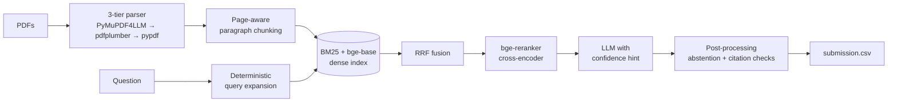
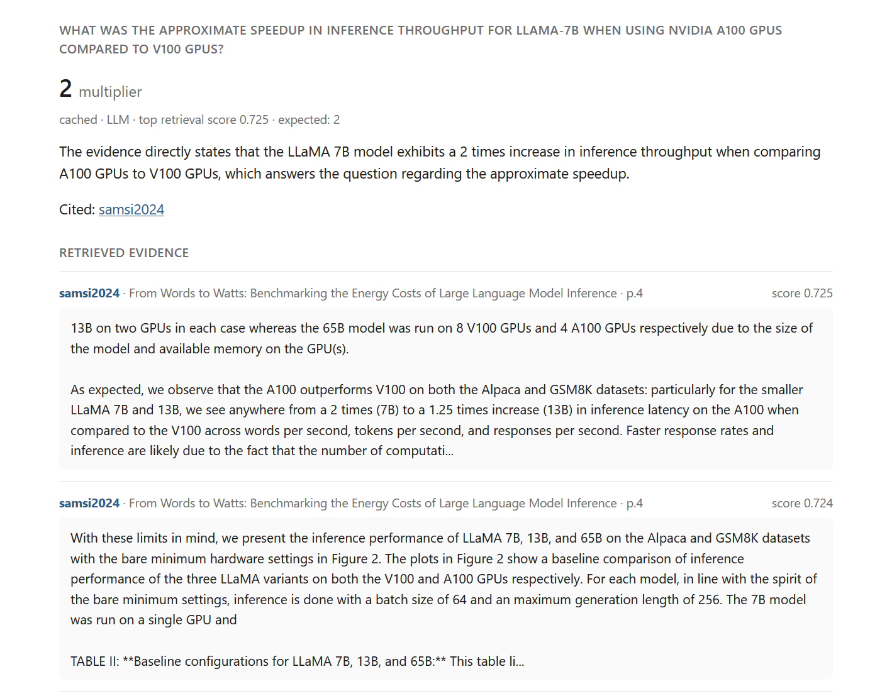

# WattBot RAG

A retrieval-augmented QA pipeline for the WattBot 2025 Kaggle competition: answer questions about the energy, carbon and water footprint of AI, using only a fixed corpus of ~30 research papers, with citations, and abstain when the papers don't contain the answer.

**Kaggle private score: 0.812** (public 0.827)

Built as a course project for CA6125 (LLM & RAG) at Nanyang Technological University.

## Pipeline





## Results

Ablation on `train_QA.csv` (41 questions), using the competition's score: `0.75 × answer_value + 0.15 × ref_id + 0.10 × is_na`.

| Configuration | answer_value | ref_id | is_na | Score |
|---|---|---|---|---|
| Rule-based baseline (BM25 + regex, no LLM) | 0.195 | 0.317 | 0.829 | 0.228 |
| + LLM generation (gpt-4o-mini) | 0.300 | 0.400 | 0.400 | 0.300 |
| + Improved prompt + query expansion | 0.512 | 0.732 | 0.902 | 0.584 |
| + PyMuPDF4LLM table extraction | 0.756 | 0.919 | 1.000 | **0.805** |
| Kaggle private leaderboard | | | | **0.812** |

The local score (0.805) tracked the private leaderboard (0.812) closely, so most iteration was done locally without spending submissions.

## Failure analysis

On the 30 precomputed demo questions (`demo/cached_answers.json`, gpt-4o-mini), 25 answers match the ground truth. The five misses fall into four groups:

| # | Question (short) | Predicted | Expected | What went wrong |
|---|---|---|---|---|
| 6 | 500 mL bottles of water per GPT-3 completion | 30 | [0.02, 0.1] | **Inverted ratio.** The paper says one bottle per 10–50 responses; the model averaged 10 and 50 instead of taking 1/50 to 1/10. |
| 19 | Days of an American's CO₂ equal to training BERT | 2.93 | 14.4 | **Outside knowledge in arithmetic.** The model supplied a daily-emissions figure from memory rather than the corpus, and cited `patterson2021` although the top retrieved chunk was the emissions table in `strubell2019`. |
| 25 | ACL papers targeting both accuracy and efficiency | 6 | 2 | **Forced guess.** Evidence had percentages but not the count; the model computed 10% × 60. The HIGH-confidence rule forbids abstaining, so it answered when it should not have. |
| 21 | Name of the 5,842-entry financial dataset | 5842 | Financial Sentiment Analysis | **Field mismatch.** The explanation names the dataset correctly, but `answer_value` copies the number from the question. |
| 11 | GPT-3 training water use, in million liters | 5.4 | 5439000 | **Label inconsistency.** 5.4 million liters is correct for the requested unit; the ground truth is given in liters. |

Possible fixes, none implemented yet:

- Flag answers whose `answer_value` already appears in the question (catches #21).
- Require every number used in a calculation to appear in the retrieved evidence (catches #19 and #25).
- Relax "never abstain on HIGH confidence" when the evidence lacks the exact quantity asked for (#25).

## Design decisions

**Table-preserving PDF parsing.** Many answers sit in tables. `pypdf` flattens tables into unordered text, so the LLM can't tell which number belongs to which row. Switching to PyMuPDF4LLM (Markdown tables) was the largest single gain (+0.221). pdfplumber and pypdf stay as fallbacks so one bad PDF can't crash the run. See `pdf_utils.py`.

**Rule-based query expansion.** Each question becomes up to six deterministic variants: keyword-only, the core statement of a True/False question, capitalised entities and numbers, author–year patterns, and so on. Each variant is searched with BM25 and the dense index, and all ranked lists are merged with RRF. This adds no LLM calls and gives the same output on every run. See `build_query_variants` in `retrieval.py`.

**Abstention enforced in code, not only in the prompt.** gpt-4o-mini still guessed on unanswerable questions even when the prompt told it to abstain. Two layers handle this:
1. A HIGH / MEDIUM / LOW retrieval-confidence hint goes into the prompt.
2. If the top retrieval score falls below `blank_relevance_threshold`, the output is overwritten with a blank record, whatever the LLM said.

See `_normalize_prediction` in `pipeline.py`.

**Citations treated as untrusted.** The `ref_id`s the LLM returns are intersected with the documents the retriever actually returned, and anything outside that set is dropped. `ref_url` is never taken from the model; it is rebuilt from `metadata.csv`. When the answer is blank, all citation fields are blanked as well, so no row is inconsistent.

## What failed along the way

- **Changing several things at once.** Early runs stacked multiple changes together, so it was impossible to tell what helped. Moving to one change per ablation step is how the table-parsing bottleneck was found: the baseline's is_na was high but answer_value was low, which pointed at bad evidence rather than bad reasoning.
- **Prompt-only guardrails.** Instructions such as "output is_blank if unsure" were not followed reliably by a small model. The fix was a deterministic check after generation.
- **Hallucinated citations.** The LLM sometimes returned document IDs that don't exist in the corpus, or mixed up URLs. The fix was the intersection and URL lookup described above.
- **Rule-based extraction.** The no-LLM baseline returns the first number in the best-matching sentence. On "How many data centers … in 2023?" it answers `2023`. This failure motivated adding an LLM step.

## Quick start

```bash
pip install -r requirements.txt
cp config.example.json config.json
cp .env.example .env          # add your OpenAI-compatible API key
```

Put `train_QA.csv`, `test_Q.csv` and `metadata.csv` from the competition in `data/`. Put the papers in `docs/` as `<id>.pdf`; if they are missing, the pipeline downloads them from the URLs in `metadata.csv`.

```bash
python -m wattbot.cli build-index --config config.json
python -m wattbot.cli evaluate   --config config.json --limit 20
python -m wattbot.cli predict    --config config.json --split test
```

Outputs are written to `work/outputs/`, and per-question retrieval traces to `work/debug/`.

**Running without an API key:** set `generation.backend` to `"rule_based"`. Setting `enable_dense` and `enable_reranker` to `false` also skips the model downloads, which is enough to check that the pipeline runs end to end.

Any OpenAI-compatible endpoint works (OpenRouter, vLLM, etc.): set `generation.base_url`.

## Project layout

```text
wattbot/
  cli.py          build-index / download-docs / evaluate / predict
  pdf_utils.py    three-tier PDF parsing
  chunking.py     page-aware paragraph chunking
  retrieval.py    BM25, dense index, query expansion, RRF, reranker
  generation.py   prompt construction, LLM and rule-based backends
  pipeline.py     orchestration and post-processing
  evaluation.py   local approximation of the competition metric
app/              FastAPI demo (server.py, service.py, static/index.html)
scripts/          build_demo_cache.py
tests/            pytest suite, run in CI
```

## Web demo

A small FastAPI app shows the answer, the cited papers, and the retrieved evidence chunks with their scores.

```bash
python -m wattbot.cli build-index --config config.json
uvicorn app.server:app --port 8000      # open http://localhost:8000
```

- **Precomputed examples** come from `demo/cached_answers.json` and cost nothing to view. Generate them once with `python scripts/build_demo_cache.py --config config.json --limit 30`; with the LLM backend, this is the only step that uses API credits.
- **Live questions** use the visitor's own API key if they enter one; otherwise they fall back to the rule-based baseline. Keys are used for that request only and are never stored or logged.

## Tests

```bash
pip install pytest
pytest -q
```

The tests cover the logic that decides the score: query expansion, the abstention threshold, citation intersection, URL reconstruction, chunk page tracking, and the local metric. They need no API key, models or PDFs, and GitHub Actions runs them on every push.

Writing them exposed a bug in the local metric: `_normalize_text` stripped commas before range parsing, so `[10,20]` became `[1020]`. Range answers were then compared as plain strings, and different ranges such as `[1,23]` and `[12,3]` could collide. This is now fixed and covered by a regression test. The ablation numbers above were computed before the fix; the Kaggle scores come from the official scorer and are unaffected.

## Limitations

- Questions that need facts from two or three papers at once: retrieval doesn't reliably surface all of them together.
- Multi-step arithmetic and unit conversion are left to the LLM; there is no calculator tool.
- Latency is several seconds per question (BM25, embeddings, reranker and LLM call).
- `evaluation.py` approximates the official scorer; it is not the hidden Kaggle metric.

## Credits

The retrieval and generation pipeline was built as a CA6125 team project at NTU (team of five). The web demo, test suite, CI and the metric fix were added afterwards as individual work. Competition and data by ML+X, University of Wisconsin–Madison. The competition data and papers are not included in this repo.
